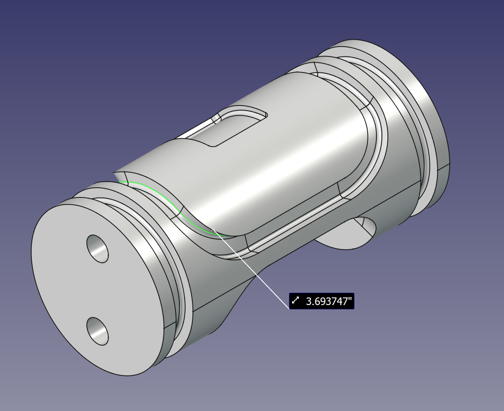

# O-ring dimension calculations and selection {: .center-text}

[Helpful YouTube tutorial](https://youtu.be/aweDWuNkPw0?si=bw4_wrT9lYy_7RHw) 
{: .center-text}

[Parker o-ring selector](https://divapps.parker.com/divapps/oring/ORingSelector?cntry=us/17563&lang=en&region=na)
{: .center-text}

### Squeeze (radial compression of o-ring):
\[\%Squeeze=\frac{W_{o-ring}-W_{c}}{W_{o-ring}}\cdot100\]

Guidelines: 
Static 10-25% 
Dynamic 8-16% 
Face 20-30% 

### Stretch (tangential stretch of o-ring in groove):
\[\%stretch=\frac{D_{groove}-D_{inner\:ring}}{D_{inner\:ring}}\cdot100\]

Guideline: 1-5%

### Gland fill:
\[\%\:fill=\frac{A_{ring}+(n_{BUR}*{A_{BUR}})}{A_{gland}}\cdot100\]

Guideline: 60-85%

## Selection of o-ring for DSV radial seal {: .center-text}

### Pre-conditions: 

\[DSV case_{\:diameter} = 0.95\:in   \]

\[DSV rotor_{diameter} = 0.93\:in   \]

\[DSV_{case\:rotor\:gap} = 0.01\:in   \]

\[O\text{-}ring_{\:diameter}=0.103\:in\:(cross\text{-}sectional)\]

\[O\text{-}ring_{\:squeeze}=0.18  \]

\[O\text{-}ring_{\:gland\:fill}=0.95  \]

\[O\text{-}ring_{\:stretch}=0.025  \]

### Analysis:

\[O\text{-}ring_{\:groove\:depth}=(O\text{-}ring_{\:diameter}-O\text{-}ring_{\:squeeze}\cdot O\text{-}ring_{\:diameter})-DSV_{case\:rotor\:gap}\]

\[\downarrow\]

\[O\text{-}ring_{\:groove\:depth}=0.0745\:in\]

\[O\text{-}ring_{\:groove\:length}=(\pi \cdot (O\text{-}ring_{\:diameter}/2)^2)/(O\text{-}ring_{\:gland\:fill} \cdot O\text{-}ring_{\:groove\:depth})\]

\[\downarrow\]

\[O\text{-}ring_{\:groove\:length}= 0.1178\:in\]

\[O\text{-}ring_{\:groove\:bottom\:diameter}=DSV case_{\:diameter}-(2\cdot DSV_{case\:rotor\:gap})-(2 \cdot O\text{-}ring_{\:groove\:depth})\]

\[O\text{-}ring_{\:groove\:bottom\:diameter}=0.7811\:in\]

\[\downarrow\]

\[O\text{-}ring_{\:ideal\:inner\:diameter}=O\text{-}ring_{\:groove\:bottom\:diameter}/(O\text{-}ring_{\:stretch}+1)\]

\[O\text{-}ring_{\:ideal\:inner\:diameter}=0.762\:in\]

<!-- \[O\text{-}ring_{\:ideal\:outer\:diameter}=O\text{-}ring_{\:ideal\:inner\:diameter}+(O\text{-}ring_{\:diameter}\cdot2)\] -->

<!-- \[\downarrow\]

\[O\text{-}ring_{\:ideal\:outer\:diameter}=0.968\:in\] -->

Now we need to pick the closest available oxygen safe match from McMaster-Carr. It can be found [here](https://www.mcmaster.com/9464K984-9464K29/).
{: .center-text}

### Let's double check the actual stretch fraction:

\[O\text{-}ring_{\:actual\:inner\:diameter}=0.737\:in\]

\[\%\:stretch=\frac{D_{groove}-D_{inner\:ring}}{D_{inner\:ring}}\cdot100\]

\[\downarrow\]

\[\%\:stretch=5.98\%\]

This is the closest match out of the available o-ring options.
{: .center-text}

## Selection of o-ring for DSV face seal {: .center-text}

### Pre-conditions: 

\[O\text{-}ring_{\:squeeze}=0.18  \]

\[O\text{-}ring_{\:gland\:fill}=0.95  \]

\[O\text{-}ring_{\:stretch}=0.025  \]

\[O\text{-}ring_{\:diameter}=0.103\:in\:(cross\text{-}sectional)\]

\[O\text{-}ring_{\:groove\:depth}=0.0745\:in\]

\[O\text{-}ring_{\:groove\:length}= 0.1178\:in\]

\[Inner\:circumference\:of\:DSV\:mouthpiece\:groove = DSV_{Inner\:circum.\:m.p.} = 3.693747\:in\]

{ align=center }

By treating the inner circumference of the DSV mouthpiece groove as if it was circular we can calculate an ideal o-ring inner diameter.

\[O\text{-}ring_{\:ideal\:inner\:diameter}= \frac{DSV_{Inner\:circum.\:m.p.}}{\pi}=1.175756187\:in\]

Now we need to pick the closest available oxygen safe match from McMaster-Carr. It can be found [here](https://www.mcmaster.com/93445K447/).
{: .center-text}

### Let's double check the actual stretch fraction:

\[O\text{-}ring_{\:actual\:inner\:diameter}=1.112\:in\]

\[\%\:stretch=\frac{D_{groove}-D_{inner\:ring}}{D_{inner\:ring}}\cdot100\]

\[\downarrow\]

\[\%\:stretch=5.73\%\]

This is the closest match out of the available o-ring options.
{: .center-text}